# HeartBridge: AI-Powered Social Impact & Humanitarian Ecosystem

[](https://github.com/nayanaastakar/HeartBridge-NGO-platform/actions)
[](https://opensource.org/licenses/MIT)
[](https://nodejs.org/)
[](https://angular.io/)
[](https://fastapi.tiangolo.com/)
[](https://www.docker.com/)

**HeartBridge** is an enterprise-grade, comprehensive humanitarian management ecosystem designed to seamlessly connect NGOs, Donors, Beneficiaries, Corporate CSR departments, Volunteers, and Emergency Response teams. Built with a modern microservices architecture comprising an Angular frontend, an Express/Node.js core backend, a Python FastAPI Machine Learning microservice, and MongoDB.

---

## 🌟 Key Highlights & Architecture

- **Role-Based Workflows**: Tailored environments for System Administrators, NGO Managers, Donors, Volunteers, and Corporate CSR partners.
- **AI & ML Intelligence**: Real-time donation forecasting, campaign success prediction, and anomaly detection via an independent FastAPI microservice.
- **Comprehensive Humanitarian Operations**: End-to-end modules covering Beneficiary Cases, Inventory Distribution, Volunteer Scheduling, and Incident Response.
- **CSR & Grant Exchange**: Direct corporate partnership pipelines, grant applications, and verified utilization reporting.
- **Financial Transparency & Payments**: Integrated Razorpay donation processing with automatic receipt generation and fund allocation tracking.
- **Production-Ready DevOps**: Docker containerization, Docker Compose multi-service orchestration, and GitHub Actions CI/CD workflows.

---

## 📸 Screenshots Showcase

### 1. Authentication & Onboarding
| Modern Split-Screen Login | Multi-Role Registration Portal |
| :---: | :---: |
| 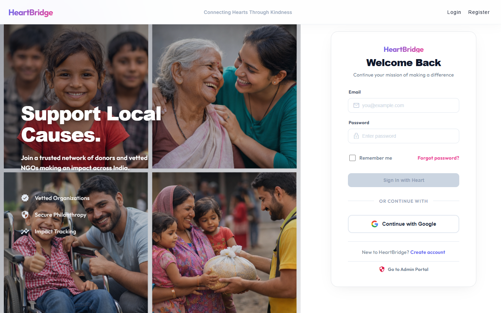 | 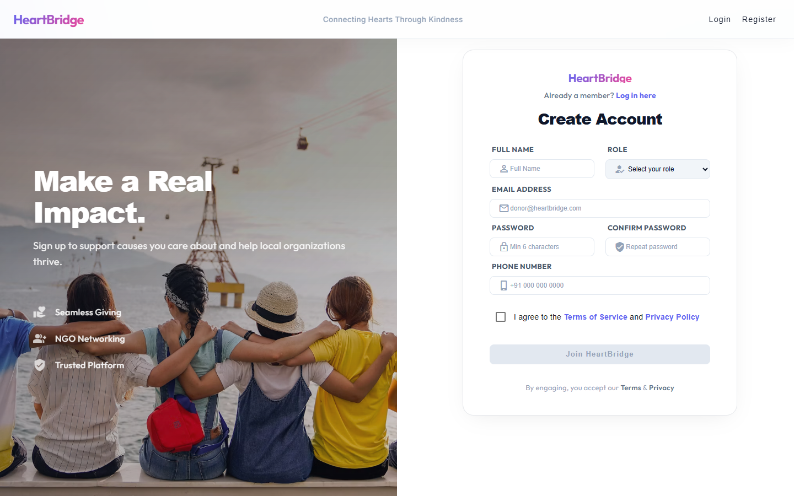 |

### 2. Operational Dashboards
| System Administrator Command Center | NGO Operations Dashboard |
| :---: | :---: |
| 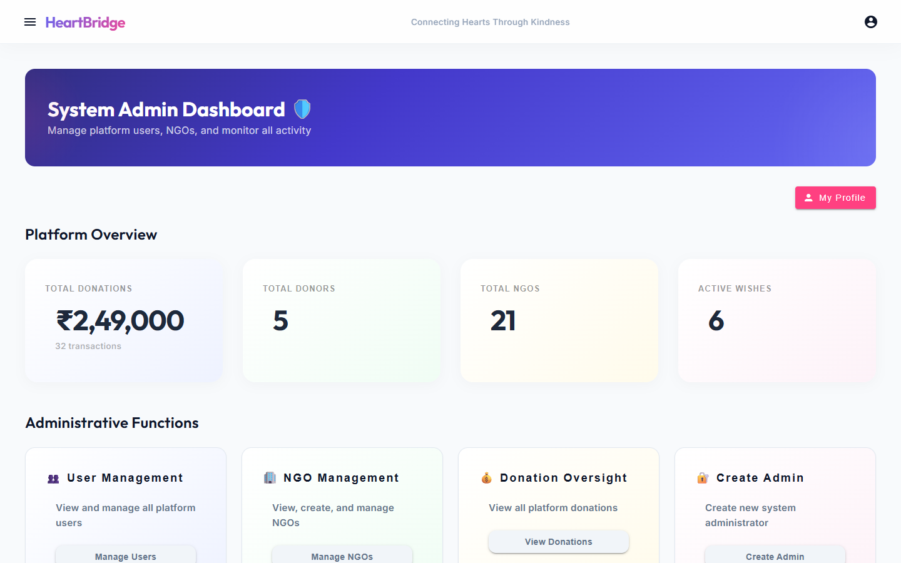 | 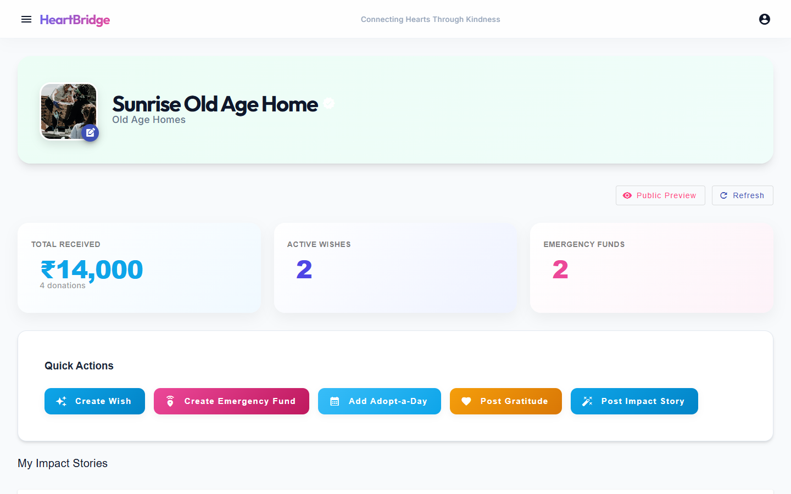 |

### 3. Community & Public Impact
| NGO Discovery Marketplace | Verified Impact Stories & Milestones |
| :---: | :---: |
| 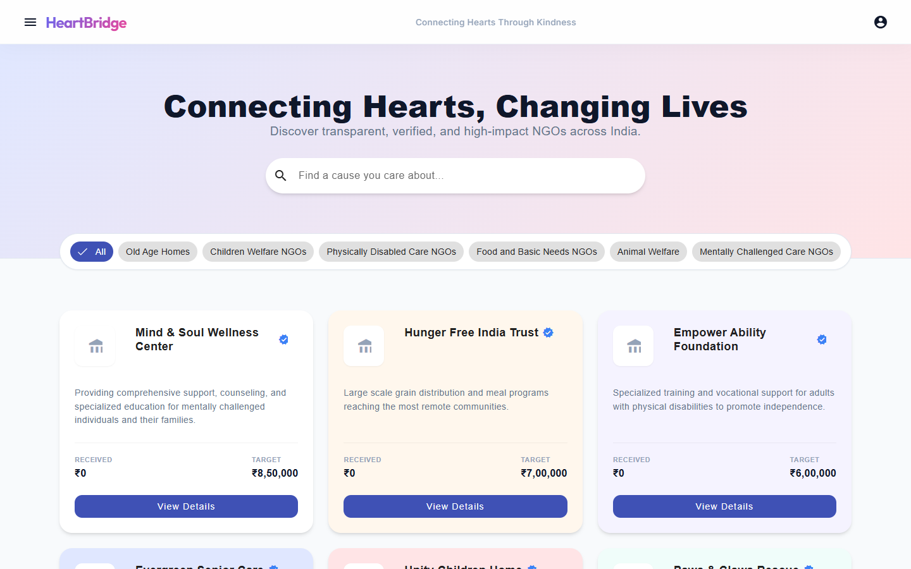 | 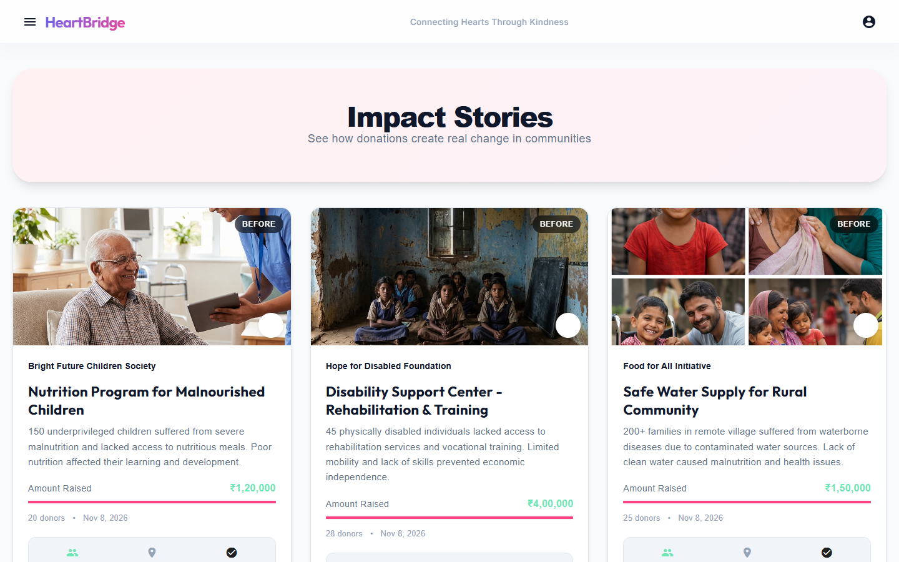 |

### 4. Interactive Community
| Discussions & Knowledge Sharing | Donor Gratitude Wall |
| :---: | :---: |
| 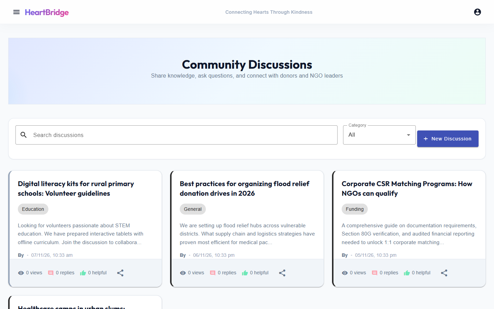 | 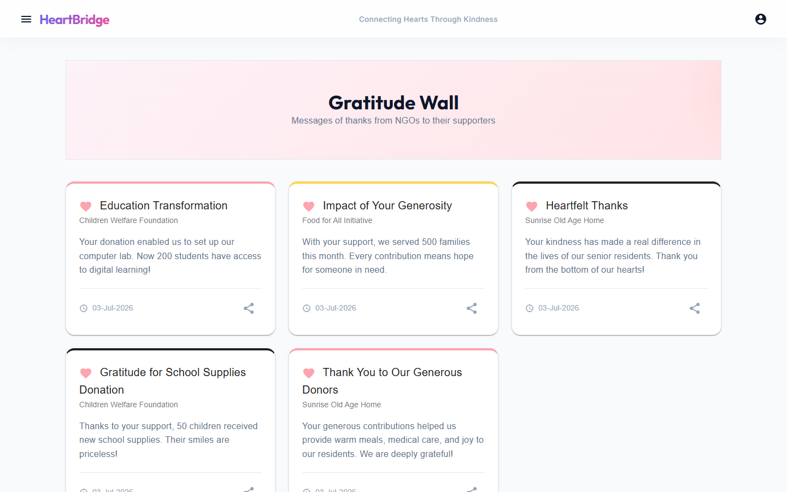 |

### 5. Enterprise Humanitarian Operations
| Volunteer Scheduling & Task Tracking | Beneficiary & Case Management |
| :---: | :---: |
| 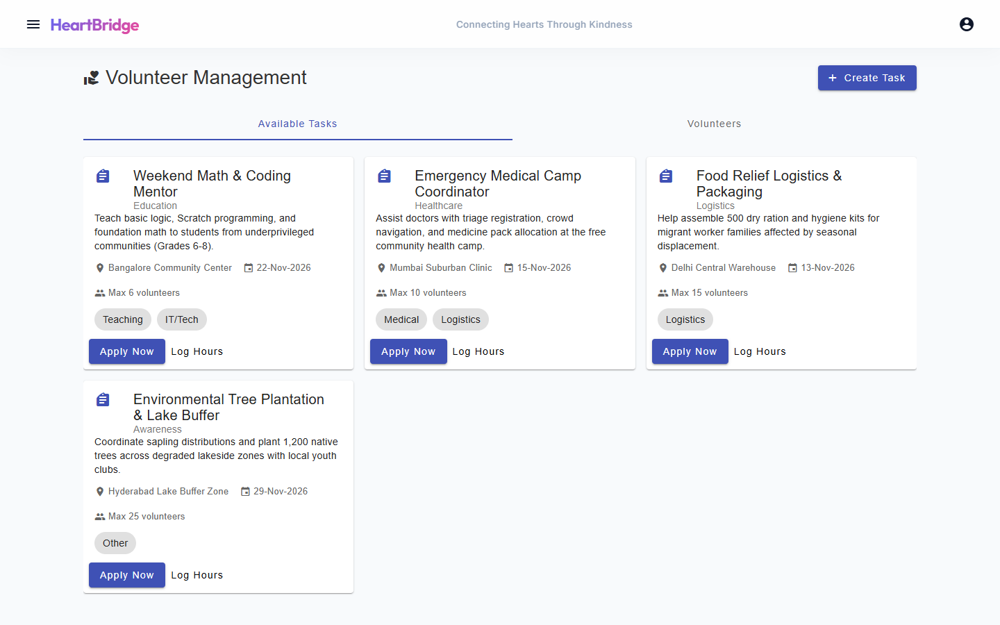 | 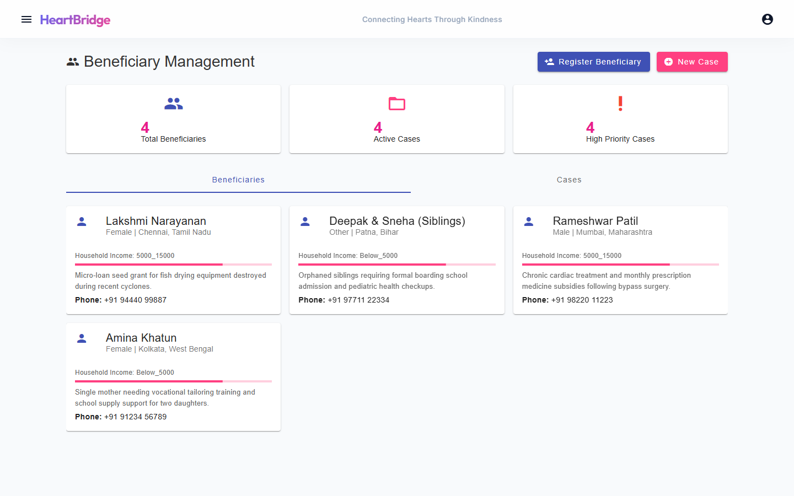 |

### 6. Resource & Disaster Management
| Warehouse Inventory & Logistics | Emergency Incident Coordination |
| :---: | :---: |
| 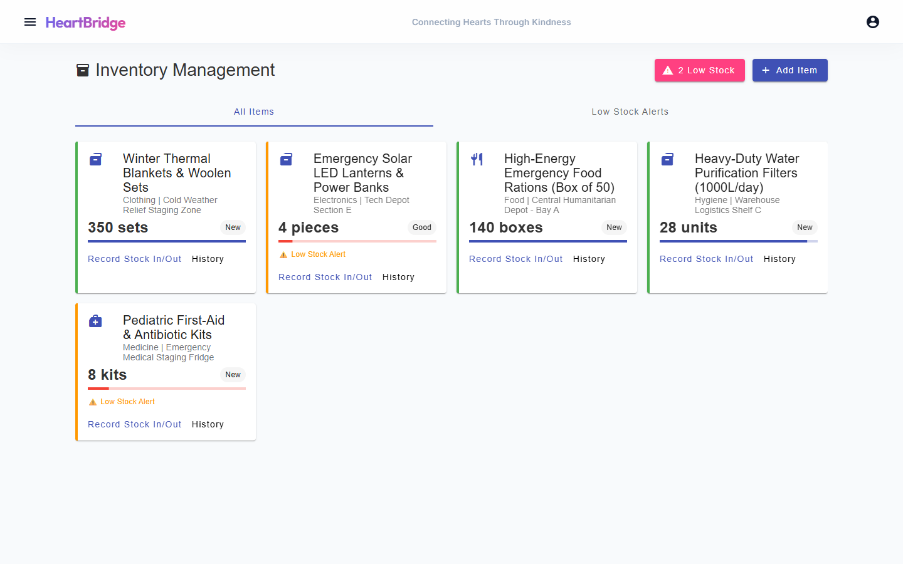 | 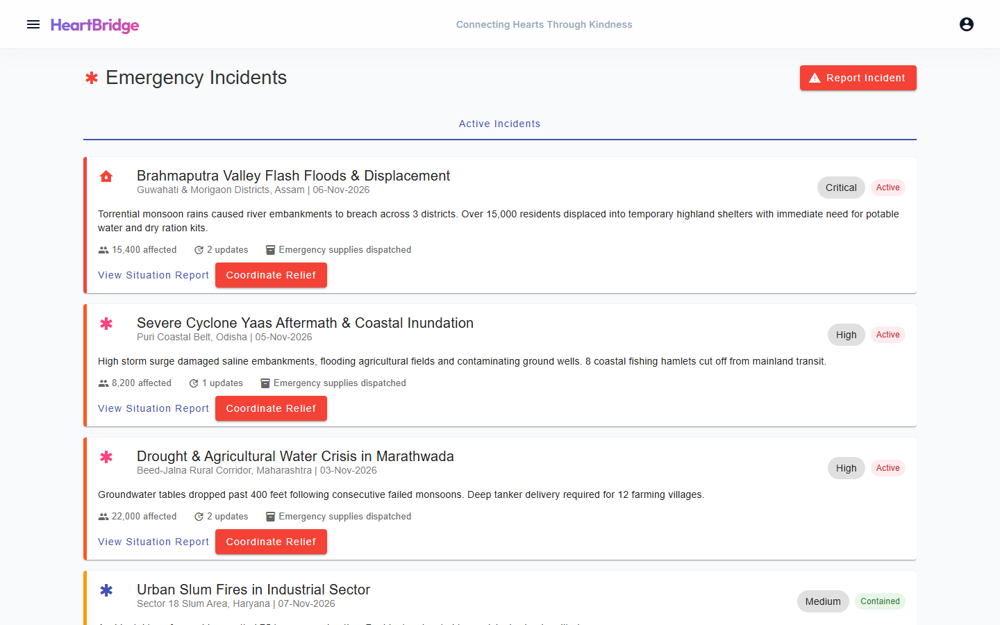 |

### 7. CSR & Predictive Intelligence
| Corporate CSR & Grant Application Portal | AI Intelligence & Donation Forecasting |
| :---: | :---: |
| 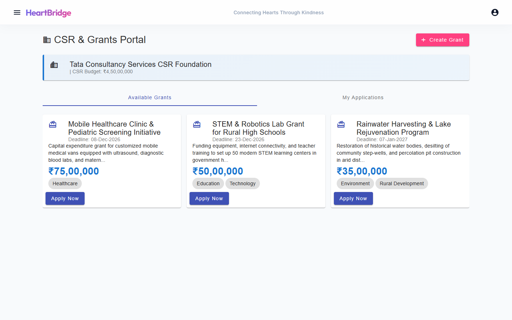 | 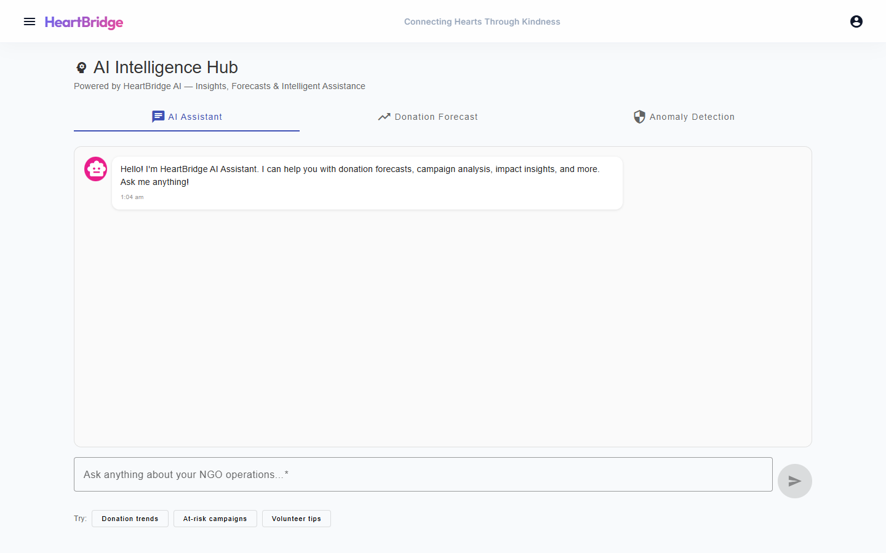 |

### 8. Donor Experience
| Donor Contribution & Tax Receipts | Urgent Wish Box Campaigns |
| :---: | :---: |
| 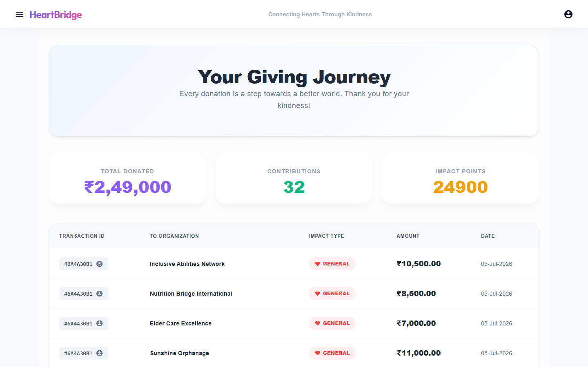 | 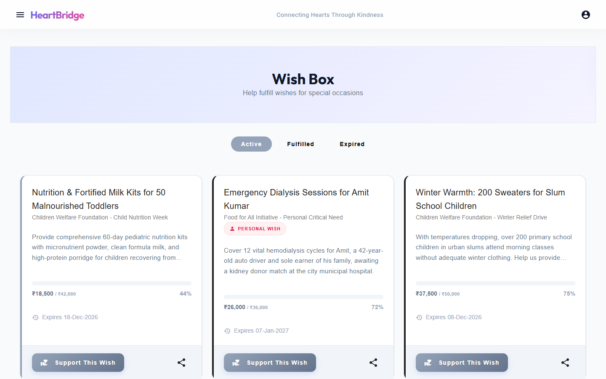 |

---

## 🛠️ Technology Stack

| Layer | Technologies |
|---|---|
| **Frontend** | Angular 16, TypeScript, Angular Material, SCSS, Chart.js / ng2-charts, RxJS |
| **Backend API** | Node.js, Express, Mongoose, JWT, Helmet.js, Express Rate Limiting |
| **AI / ML Service** | Python 3.11, FastAPI, Uvicorn, Scikit-learn, Pandas, NumPy |
| **Databases & Cache**| MongoDB, Redis |
| **Container & CI/CD** | Docker, Docker Compose, GitHub Actions |
| **Testing & Automation**| Playwright, Jest / Supertest |

---

## 🚀 Quick Start Guide

### Option 1: Docker Compose (Recommended)

Run the entire ecosystem with a single command:

```bash
docker-compose up --build
```

Access the services:
- **Web Application**: `http://localhost`
- **Core Backend API**: `http://localhost:3001`
- **AI Intelligence Service**: `http://localhost:8001`
- **MongoDB**: `localhost:27017`

---

### Option 2: Local Development

#### Prerequisites
- Node.js v18+ & npm
- Python 3.10+
- MongoDB running locally on `localhost:27017`

#### 1. Backend Setup
```bash
cd backend
npm install
npm run dev
# Running at http://localhost:3001
```

#### 2. AI Microservice Setup
```bash
cd ai-service
pip install -r requirements.txt
python main.py
# Running at http://localhost:8001
```

#### 3. Frontend Setup
```bash
cd frontend
npm install
npm start
# Running at http://localhost:4201
```

---

## 🔐 Demo Credentials

All test accounts use the password: `password123`

| Role | Email | Capabilities |
|---|---|---|
| **System Administrator** | `admin@heartbridge.com` | Full governance, verification, user & system management |
| **NGO Administrator** | `ngo1@heartbridge.com` | Campaign creation, inventory, beneficiaries, volunteer tasks |
| **Donor** | `donor@heartbridge.com` | Explore NGOs, donate via Razorpay, track contributions, log volunteer hours |

---

## 📁 Repository Structure

```tree
HeartBridge-NGO-platform/
├── .github/workflows/ci.yml       # CI/CD Automated Pipelines
├── ai-service/                    # FastAPI AI/ML microservice
│   ├── main.py                    # Predictive forecasting & anomaly engine
│   ├── Dockerfile
│   └── requirements.txt
├── backend/                       # Express Node.js core backend
│   ├── controllers/               # Business logic controllers
│   ├── models/                    # Mongoose database models
│   ├── routes/                    # REST API route handlers
│   ├── middleware/                # Security, RBAC & error handlers
│   ├── Dockerfile
│   └── server.js
├── frontend/                      # Angular SPA application
│   ├── src/app/components/        # 30+ enterprise UI components
│   ├── src/app/services/          # Centralized reactive HTTP services
│   ├── Dockerfile
│   └── nginx.conf
├── docs/images/                   # Fresh Playwright UI verification screenshots
└── docker-compose.yml             # Full-stack multi-container specification
```

---

## 📄 License

This project is licensed under the MIT License - see the [LICENSE](LICENSE) file for details.
